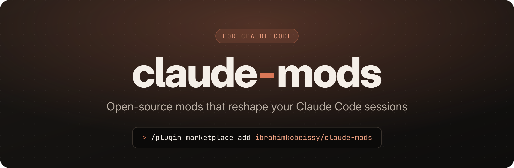

<p align="center">
  
</p>

<p align="center">
  <a href="LICENSE"></a>
  <a href="https://github.com/ibrahimkobeissy/claude-mods/actions/workflows/validate.yml"></a>
  <a href="https://github.com/ibrahimkobeissy/claude-mods/stargazers"></a>
  <a href="CONTRIBUTING.md"></a>
  
</p>

<p align="center">
  <b>Panes, status lines, toasts, tool guards and slash commands</b><br>
  dropped into Claude Code with one command and hot-reloaded while you work.
</p>

<p align="center">
  <a href="#-quick-start">Quick start</a> ·
  <a href="#-mods">Mods</a> ·
  <a href="#-build-your-own">Build your own</a> ·
  <a href="CONTRIBUTING.md">Contribute</a>
</p>

---

## ✨ What's a mod?

A **mod** is a Claude Code plugin built from *function hooks*: a small TypeScript module that hooks the engine's events and changes what Claude Code does or draws.

```ts
export const register: Register = on => {
  on('tool.call', { tool: 'Edit' }, ($, e, next) =>
    /\.env$/.test(e.file_path) ? { deny: 'not touching .env' } : next(e),
  )
}
```

With one, you can:

| | |
| --- | --- |
| 🪟 **Panes & bands** | Live side panels and rows above the prompt, drawn in JSX |
| 📊 **Status & toasts** | Put your own text on the status line or pop a notification |
| 🛡️ **Tool guards** | Block, rewrite or react to any tool call before or after it runs |
| ⌨️ **Slash commands** | Register `/your-command` and answer it from code |
| 🧠 **Prompt shaping** | Rewrite prompts or add sections to the system prompt |
| 🔊 **Timers, files, sounds** | Run work on a clock, touch files, play audio |

## 🚀 Quick start

Inside Claude Code, add this repo as a marketplace:

```text
/plugin marketplace add ibrahimkobeissy/claude-mods
```

Then install any mod from it:

```text
/plugin install <mod-name>@claude-mods
```

Or from your shell:

```bash
claude plugin marketplace add ibrahimkobeissy/claude-mods
claude plugin install <mod-name>@claude-mods
```

Update later with `claude plugin update <mod-name>@claude-mods`, then `/reload-plugins` in a running session.

## 🧩 Mods

| Mod | What it does | Install |
| --- | --- | --- |
| _Coming soon_ | The first mods are on their way. [Suggest one →](https://github.com/ibrahimkobeissy/claude-mods/issues/new?template=mod_request.yml) | |

<!-- Add a row per mod, in alphabetical order:
| [`mod-name`](mods/mod-name) | One line on what it does | `/plugin install mod-name@claude-mods` |
-->

## 🛠️ Build your own

Every mod lives in its own folder under [`mods/`](mods) and is three small files:

```text
mods/my-mod/
├── .claude-plugin/plugin.json   # name, version, description
└── hooks/
    ├── hooks.json               # { "modules": ["./register.ts"] }
    ├── register.ts              # export const register: Register = (on, options) => { ... }
    └── register.test.ts         # tests, run by `claude plugin test`
```

**1. Scaffold** from the starter in [`template/`](template):

```bash
scripts/new-mod.sh my-mod "One line on what it does"
```

**2. Try it live** — load the folder into a session and every save hot-reloads it:

```bash
claude --plugin-dir mods/my-mod
```

**3. Check it** — validates the marketplace and runs every mod's tests:

```bash
scripts/validate.sh            # everything
scripts/validate.sh mods/my-mod
```

> [!TIP]
> Ask Claude Code itself to *"make a mod that…"*. Its built-in `plugin-authoring` skill knows the full hooks API, writes the mod, and loads it into your session with hot reload.

## 📁 Repository layout

```text
.claude-plugin/marketplace.json   # the catalog `/plugin marketplace add` reads
mods/                             # one folder per published mod
template/                         # starter mod copied by scripts/new-mod.sh
scripts/                          # new-mod.sh, validate.sh
assets/                           # banner and social preview (SVG sources + PNGs)
```

## 🤝 Contributing

New mods, fixes and ideas are all welcome. Read [CONTRIBUTING.md](CONTRIBUTING.md) for the checklist a mod needs before it's merged, and please follow the [Code of Conduct](CODE_OF_CONDUCT.md).

Mods run inside your Claude Code session with the same reach as any plugin. Read a mod's source before you install it, and report anything unsafe as described in [SECURITY.md](SECURITY.md).

## 📜 License

[MIT](LICENSE) © Ibrahim Kobeissy

<sub>claude-mods is a community project and is not affiliated with or endorsed by Anthropic. Claude and Claude Code are trademarks of Anthropic, PBC.</sub>

<p align="right"><a href="#">↑ back to top</a></p>
