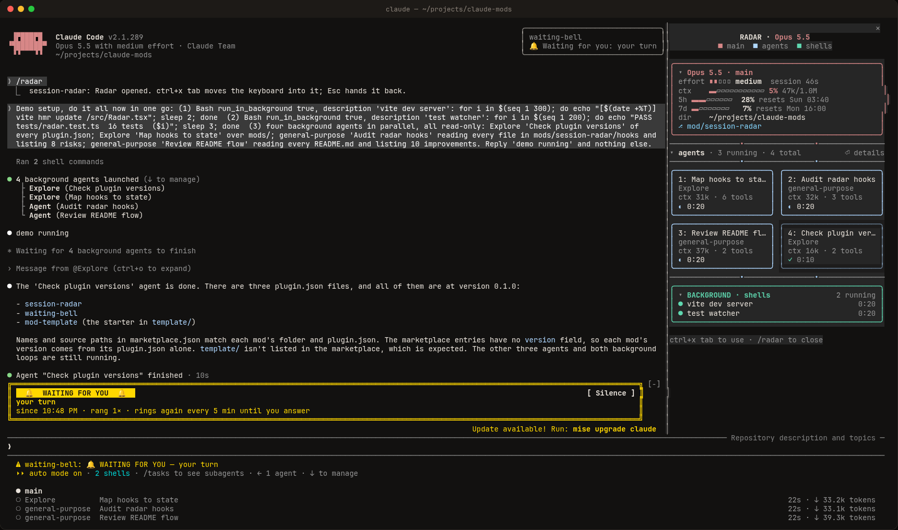
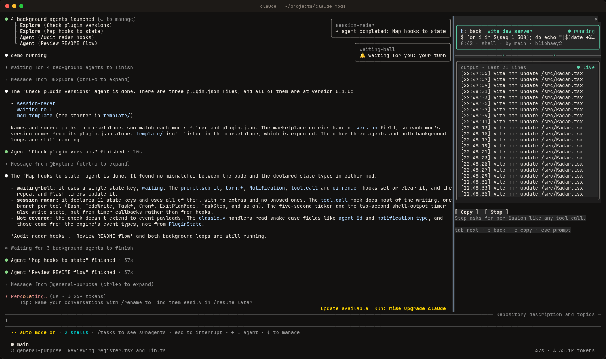

# 📡 session-radar

**A live sidebar for long Claude Code sessions.** Usage limits, context, agents, MCP servers, skills, background shells and progress, all in one small pane next to your transcript. It changes none of Claude Code's own behaviour.

<p align="center">
  
</p>

## Install

```text
/plugin marketplace add ibrahimkobeissy/claude-mods
/plugin install session-radar@claude-mods
```

It opens by itself when a session starts, wherever it fits as a sidebar. `/radar` opens or closes it at any time.

## What it shows

Each part of the session gets its own colour-coded box:

| Box | What's in it |
| --- | --- |
| **⚠ Needs you** (yellow) | Shown while a permission prompt, a question or a plan approval is waiting, with who it's from and for how long |
| **Main** (orange) | Model, effort, context gauge (turns yellow, then red with "compaction soon"), 5-hour and 7-day limits with reset times, **when the 5h window fills at your current pace**, the folder the session runs in, and your git branch or worktree |
| **Agents** (lavender) | Up to four cards, one per subagent: task, type, context, tool calls, errors, branch or worktree, running time, and the MCP server or skill it is using right now. Select a card to see its last message |
| **MCP** (sky) | Every connected MCP server with its tool count, in two rows (`+ N more` shows the rest). A server lights up while one of its tools is being called, with the tool and who called it |
| **Skills** (pink) | The skills in use right now, by main or by agent. A skill counts as in use from when it is invoked until that agent's turn ends, so when Claude is idle nothing is lit. `+ N available` lists every skill, the ones in use highlighted |
| **Background** (green) | The background shells and monitors the footer counts (`1 shell · 4 monitors`), running ones first, each with its process ID (teal), including those subagents started, plus scheduled cron jobs and `/loop` wakeups. Select one to open its live output, exit code and test result |
| **Progress** (purple) | The task list and the approved plan, shown only when there is one |

You also get a toast when a background shell or agent finishes or fails.

### A background shell, opened

<p align="center">
  
</p>

You get the last lines of output, refreshed every 2 seconds. **Copy** puts them on your clipboard. **Stop** calls `TaskStop`, which asks for permission like any other tool call.

## Keys

The radar never takes over your keyboard. While you type at the prompt, every Claude Code shortcut works as it always does.

| Key | Where | Does |
| --- | --- | --- |
| `ctrl+x tab` | prompt | Moves the keyboard into the pane (press it again if another plugin's band is showing) |
| `tab` / `shift+tab` | pane | Next / previous row |
| `enter` | pane | Open a shell, show an agent's last message, fold or unfold a box |
| `↑` `↓` | pane | Scroll |
| `b` / `c` / `s` | shell view | Back / copy / stop |
| `esc` | pane | Back to the prompt |

You can also click rows.

## Options

| Option | Default | |
| --- | --- | --- |
| `autoOpen` | `true` | Open the radar when a session starts. When opened this way it only appears where it fits as a sidebar (144+ columns); in a narrower terminal, type `/radar` |

Set it from `/plugin` → session-radar → configure.

## Good to know

- The pane docks as a sidebar in the fullscreen layout. In a narrow terminal it opens above the prompt instead and scrolls.
- Limits appear once the first API response reports them, and only on a Claude subscription. The 5h forecast appears after about 5 minutes of usage data.
- An agent's context is shown in tokens (from its last model request), since agents can run on different models.
- It tracks what happens while it's loaded. Shells and agents started before you installed it won't show up.

## Permissions and privacy

It reads your session's own events and runs `git rev-parse` locally to find branches. While a background shell runs it reads the last line of its output file (where Claude Code writes `[exited with code N]`) and runs `ps` to find its process ID. No network access, and nothing is written to disk.

## Develop

```bash
claude --plugin-dir mods/session-radar       # try it live; saves hot-reload
scripts/validate.sh mods/session-radar       # validate + run tests/
```
