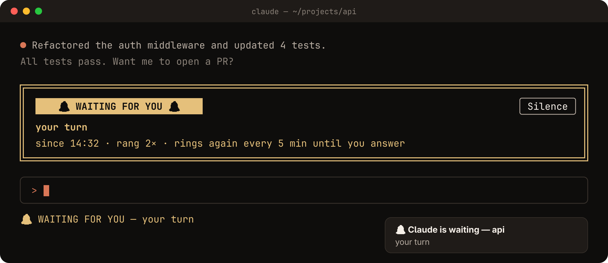

# 🔔 waiting-bell

**Never leave Claude idle again.** Rings a bell, pops a desktop notification, and shows a flashing banner whenever Claude is blocked waiting for you, then rings again every 5 minutes until you answer.

<p align="center">
  
</p>

## Install

```text
/plugin marketplace add ibrahimkobeissy/claude-mods
/plugin install waiting-bell@claude-mods
```

## When it rings

| Claude is waiting because… | Banner says |
| --- | --- |
| It finished its turn | `your turn` |
| A permission dialog is open | the permission message |
| An MCP server asks for input | the elicitation message |
| It asked you a question (`AskUserQuestion`) | `a question for you` |
| It wants a plan approved (`ExitPlanMode`) | `plan approval` |

It rings only when the main session is really waiting on you:

- **Not while background agents are still running.** When they finish, the main session is woken to handle them, so it isn't your turn yet.
- **Not for a finished background shell or agent.** The session handles the notice by itself. If you were already being called, that same wait carries on afterwards without ringing again.
- **Not for subagent turns or turns you interrupted.**

A "your turn" wait ends when you send a prompt or press **Silence**. A permission prompt, question or plan approval ends as soon as it's answered.

## What each ring does

- A **banner** above the prompt that flashes red/yellow for ~10 seconds, with when it started and how many times it has rung
- A **status line** entry and a **toast** in Claude Code
- A **sound** and a **desktop notification**, using whatever your OS already has:

| OS | Sound | Notification |
| --- | --- | --- |
| Linux | `pw-play` → `paplay` → `canberra-gtk-play` → `aplay` (first that works) | `notify-send` (critical), plus `hyprctl notify` under Hyprland |
| macOS | `afplay` (Glass) | `osascript` notification |
| Windows / WSL | PowerShell `SoundPlayer` | PowerShell tray balloon |

## Permissions and privacy

It runs only the local commands listed above (plus `uname -s` to tell Linux from macOS), and reads three environment variables to detect the platform: `OS`, `WSL_DISTRO_NAME`, `HYPRLAND_INSTANCE_SIGNATURE`. The notification shows the project folder's name and the waiting reason. No network access, nothing written to disk.

## Develop

```bash
claude --plugin-dir mods/waiting-bell       # try it live; saves hot-reload
scripts/validate.sh mods/waiting-bell       # validate + run tests/
```
